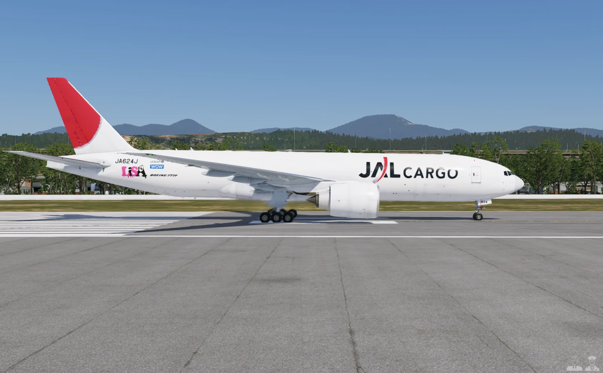
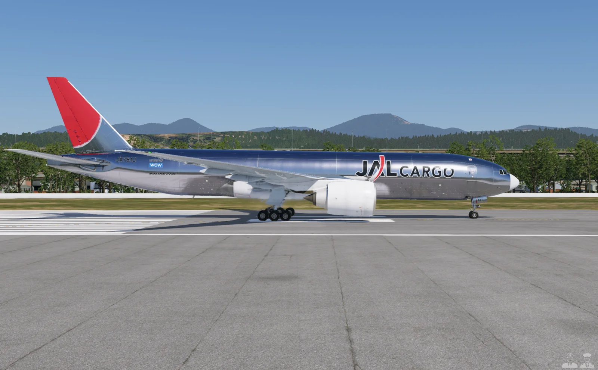
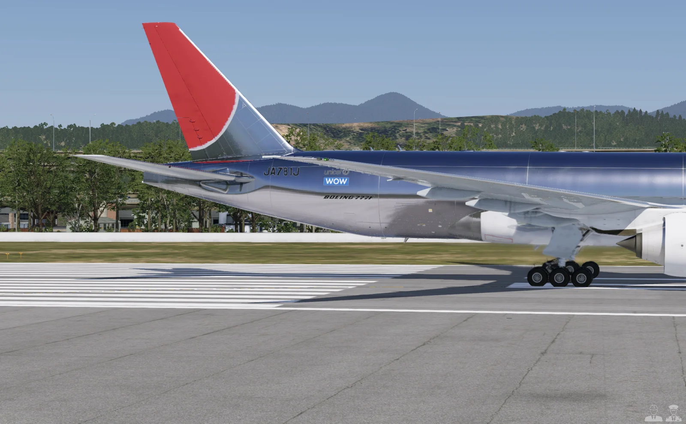
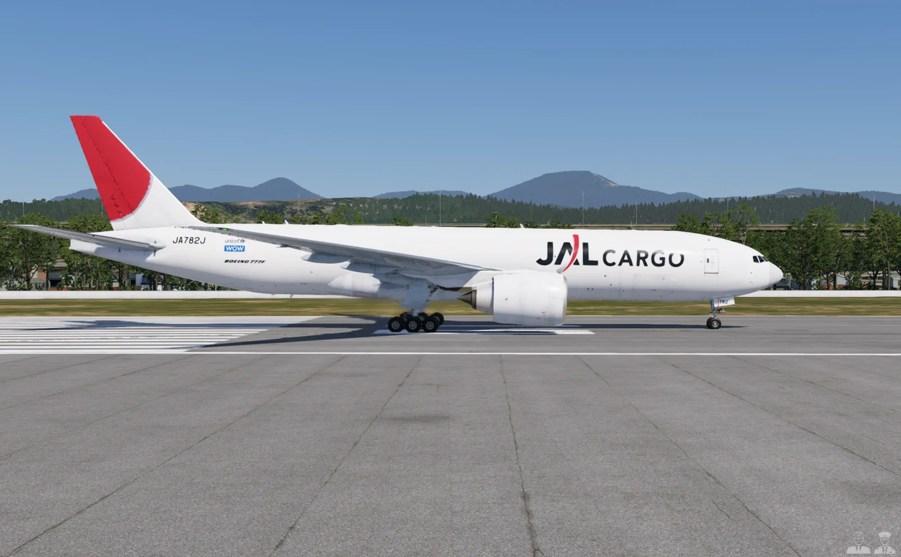
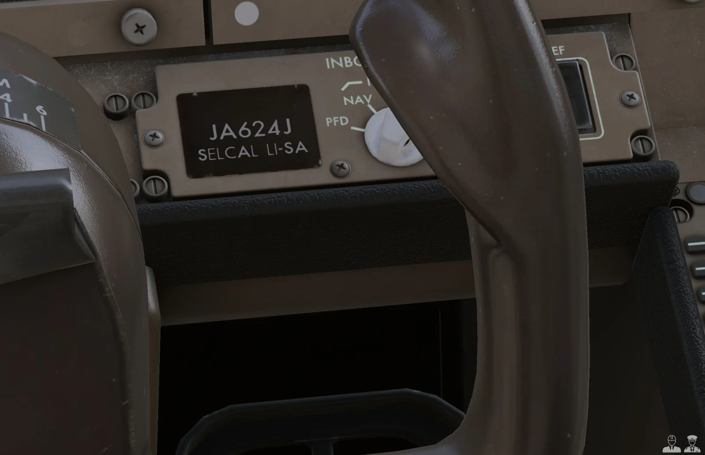
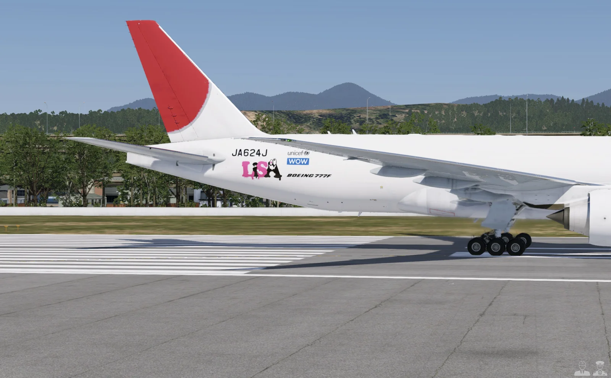
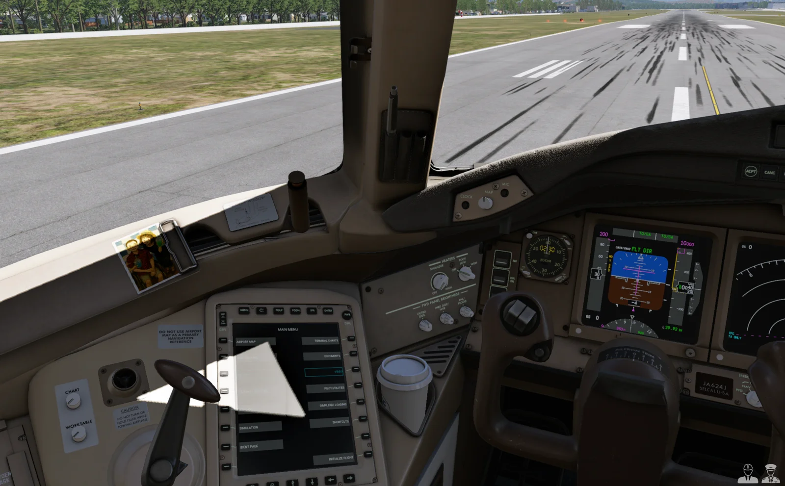
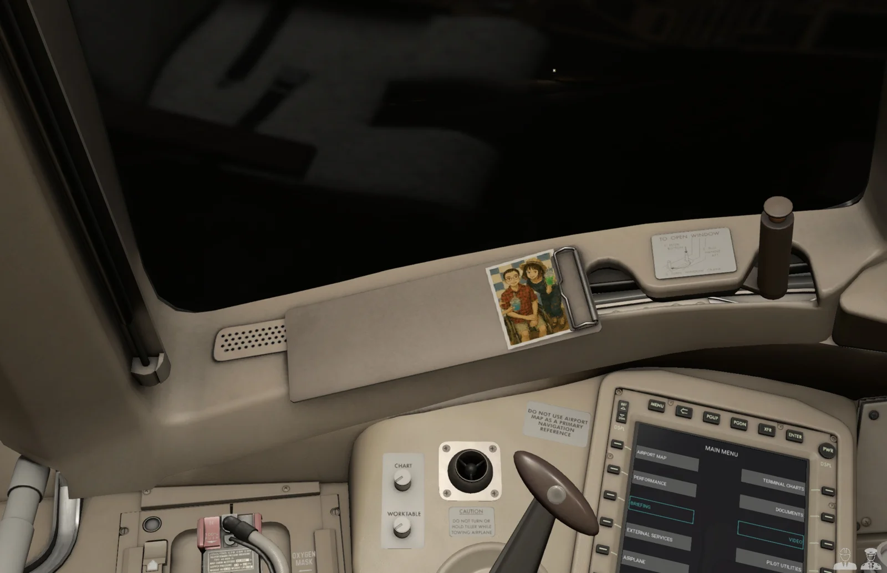

# 十年的夢：在 X-Plane 做出一架從沒存在過的 JAL CARGO 777F

機號裡的一個「4」，最後是在 JA401J 的機腹照片裡找到的。翼下那串機號要先轉正，才能把字取出來，放到我自己的飛機上。

11 月 8 日，我在 X-Plane 12 裡，替 FlightFactor 777 v2 的貨機版做了 JAL CARGO 塗裝。下午下載 paint kit，到傍晚做完，花了一個下午。做完那一刻，我只想說：「這是我一直想做的事，終於在今天完成了。我這樣會不會太瘋狂？哈哈！」

JAL 並沒有 777 貨機。這架飛機想像的是：如果 JAL CARGO 有一架 777F，會長什麼樣子。大約 2015 年，PMDG 777 剛推出 Prepar3D 版那時候，[朋友](https://www.facebook.com/kobatokasamori54/)在 Prepar3D 上做過一套 JAL CARGO 塗裝，我是拿來用的那個人。他也是〈[在虛擬天空中找自由：模擬飛行二十年](https://b-log.to/life-stories/flight-sim-20-years-freedom/)〉裡帶我入坑的那位朋友。也因為他做得夠好，這十年來我一直記得有這麼一架飛機，連他自己都忘了。這次把他當年做的兩個版本，重新放到這架貨機上。

*私人版 JA624J，X-Plane 12 實際畫面。*

## 機身上的字，不能拿系統字型湊

我想重做的是「太陽之弧」那一代的 JAL CARGO。A 版是銀色金屬機身，參考 JA631J 到 JA633J 那幾架 767 貨機；B 版是全白機身，主貨艙門上有一條寫著 SUPER LOGISTICS 的銀色斜帶，參考的是 1990 年代的 747 貨機 JA8171。兩個版本的參考年代不同，這次都用在想像中的 777F 上。原先用的機號 JA781J 也是借來的，現實中它是一架 JAL 787-9。

A、B 這兩個公開版會發布。不過我真正希望的，不是由我來發，而是由他重做一次，畢竟當年那套已經是很久以前的事了。

過程裡我一直堅持一條：機身上的字，不准隨便拿系統字型補。

JAL 和那道弧，可以用 Wikimedia Commons 上的官方向量標誌。CARGO 不在那份檔案裡，就得從四張照片描。每張先把照片上的 JAL 對準向量標誌，校正透視，再把 CARGO 的形狀平均起來。

參考照片的原圖，後來改由我在自己的瀏覽器下載。

機號更零碎。J、A 從 767 貨機的照片取，8、1 從 747 取，7 只找得到 JA8171 的三張照片，每張字高只有 11 到 14 像素。後來做私人版，需要一個原本沒有的「4」，才一路找到 JA401J 的翼下機號。後機身的機號也照 767 實機 JA633J 的排法往前移了 1.55 公尺，免得從下面看時，最後一個 J 被水平尾翼擋住。

機身上的 BOEING 777F，我記得網路上有人做過仿這段字的字型，後來找到 Sugiyasu 做的免費 BOEING-style 字型。第一版照 767 貨機寫成 BOEING 777，晚上我想起 777 貨機的字應該有 F，查了 AeroLogic D-AALA 和華航 B-18771 的實機照片，確認兩架都寫 BOEING 777F，才改過來。至於照片裡只有 8 到 10 像素高的 We support、Member of，描不出來就不放，不拿別的字型補上去。

銀色機身也有另外處理。機身在法線貼圖的金屬度通道設成金屬，讓模擬器算出反光，不是把機身塗成灰色就結束。

*公開 A 版，銀色金屬機身，X-Plane 12 實際畫面。*

*A 版右後機身，機號後移過，BOEING 777F 的 F 也補上了。*

*公開 B 版，全白機身。*

尾翼的紅色也重調過。X-Plane 12.2.0 起，畫面的色調映射換成 AgX，會把紅色往橘色推。貼圖填官方的 JAL 紅 #E21F2A，畫出來卻是偏橘的 #DA6545，從早上到傍晚都一樣，不是光線的問題。在 X-Plane 裡對尾翼做了兩輪色帶校正，貼圖最後改填 #AF003C，畫出來約 #BD3E41，看起來就是 JAL 紅。尾翼和字標上的鶴弧都用這個值。

## 連駕駛艙的小牌子也換掉

機長面前原本寫著「FF-STS / B-777」的小牌子，也換成這架飛機的機號。字從 FlightFactor 駕駛艙自己的標示文字貼圖裡切出來，和周圍的牌子用同一套字。

私人版的牌子，最後寫成「JA624J / SELCAL LI-SA」。一開始寫的是 SELCAL LISA，我還以為 SELCAL 中間都有一個點，查過才知道，中間應該是一槓，四個字母分成兩組。

結果 LI-SA 還是不合規，因為 SELCAL 不能用 I。這架私人版的牌子就留著這個寫法。

*機號牌已換成 JA624J。LI-SA 是這架私人版留下的字樣，不是有效的 SELCAL 識別碼。*

## 私人版 JA624J，轉頭就看得到合照

另外這架 JA624J，只給我自己飛。白色機身，後面放 LiSA 標誌，駕駛艙裡再放一張手繪風的合照，這張是用 GPT Image 做的。

*私人版右後機身的 LiSA 標誌與 JA624J 機號。*

合照的位置換了四次。放在窗後面板上太模糊，放在窗框立柱會被擋住，移到窗台又太後面。我要的位置很直接：轉頭就看得到，而且要看得清楚。最後放在機長前側窗下，原本就有金屬夾子的那塊板子上，還特別留出金屬夾，沒有把它蓋掉。

*從機長座位往左前看，合照在窗台上，機號牌也在畫面右下方。*

*合照最後的位置。這張是傍晚的實際畫面，和前面的白天截圖不同。*

這架私人版可以寫進文章，也可以放截圖，但塗裝檔本身不發布、不提供下載。LiSA 標誌有別人的版權，合照是私人內容，檔案就留在我自己這裡。

做完以後，坐在機長座位往左前看，就能看見那張合照。

You have control.
