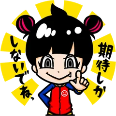
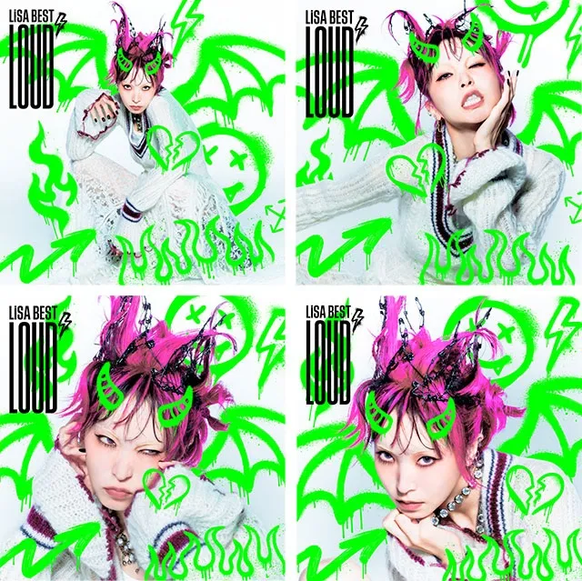
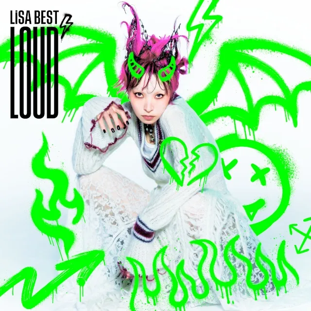
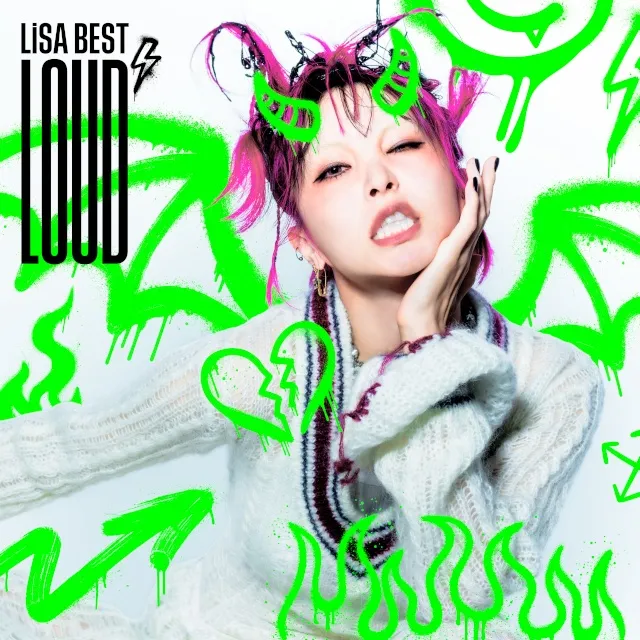
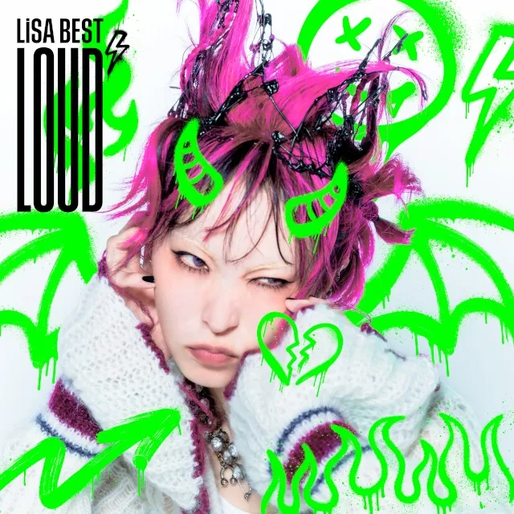
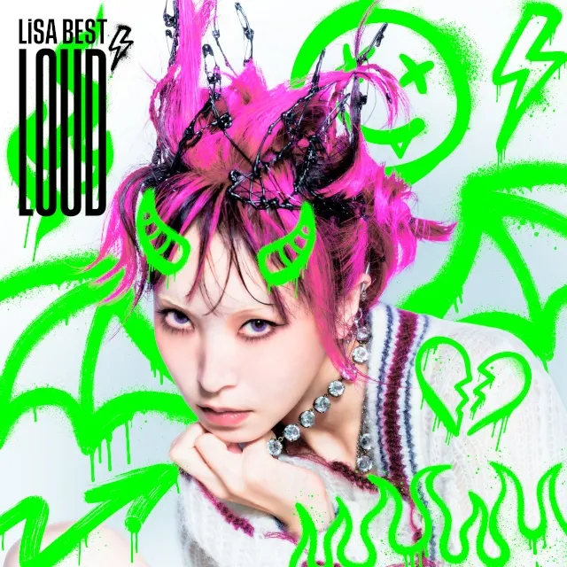
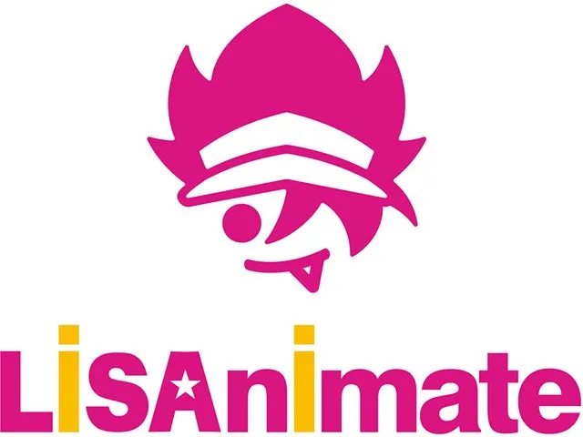
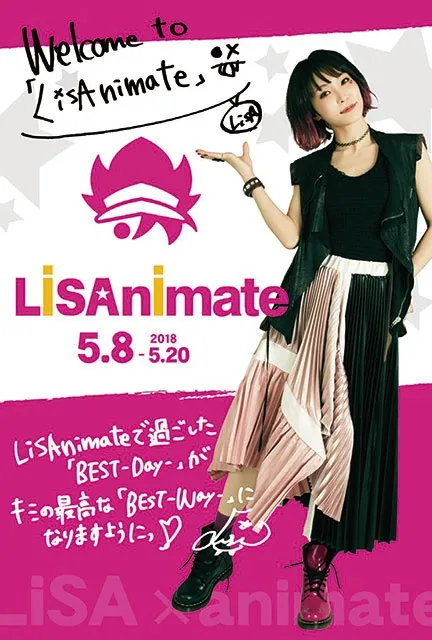

# LiSA 精選輯「LiSA BEST -LOUD-」專訪｜希望大家享受一路走來的軌跡

  
  
Crossing Field / Interview Dispatch

  
迎接個人出道 15 週年的 LiSA，將於 2026 年 12 月 2 日發行睽違約 8 年的精選輯「LiSA BEST -LOUD-」。DISC1 以電視動畫《鬼滅之刃》竈門炭治郎 立志篇片頭曲「紅蓮華」揭開序幕，以近年引領 LiSA 前行的歌曲為主，共收錄 17 首；從「ROCK-mode」開始的 DISC2，一字排開 17 首在演唱會上與粉絲一起養大的歌曲。這張作品不只推薦給長年支持她的粉絲，也推薦給想開始認識她音樂的人，當作入門也是最好的一張。「LOUD」這個標題裡，有 15 年來一直在吶喊的 LiSA 自己，也有她對演唱會的心意。這次專訪談到的內容很廣，包括選曲的背景、15 週年演唱會、電影《完美配對謀殺案：真愛》主題曲「Sophilia（ソフィリア）」的製作，以及她用「我還在吶喊喔」形容的此刻心境。

  
關鍵詞：LiSA、LiSA BEST -LOUD-、精選輯、15 週年、紅蓮華、ROCK-mode、oath sign、Sophilia、專訪翻譯

> 翻譯報導
>
> 原文：[アニメイトタイムズ〈これまでの軌跡を楽しんでほしい──「紅蓮華」から「ハウル」まで、全34曲。ベストアルバムに込めた想いと15周年の“LOUD”「LiSA BEST -LOUD-」インタビュー〉](https://www.animatetimes.com/news/details.php?id=1793884825)
>
> 發佈：2026 年 11 月 19 日
>
> 採訪：逆井マリ
>
> 攝影：原文未標明

---

## 迎接 15 週年，再次面對 LiSA 的「LOUD」

——完成了一張非常棒的精選輯呢。

**LiSA**　謝謝，這張專輯超級可愛的喔。

——繼上次的精選輯「LiSA BEST -Day-」「LiSA BEST -Way-」之後，能不能請你再談談這次決定發行精選輯的經過？

**LiSA**　因為適逢 15 週年，我有很多回顧自己的機會。回顧一路走來的軌跡時，我發現距離上次的精選輯「LiSA BEST -Day-」「LiSA BEST -Way-」已經過了 8 年。說起來就像進入第 2 階段一樣，從那之後又誕生了許多王牌級的歌曲。

經過 15 週年 Arena 巡演「LiVE is Smile Always～15～（iCHiNiTSUiTE GO）」後，為了能和大家一起邁向下一個階段，我也希望大家能先在這裡好好慶祝一番，同時享受一路走來的軌跡。

——這次的標題是「LOUD」。為什麼想把靈魂寄託在這個詞上？

**LiSA**　我在尋找一個詞，能同時象徵自己走過的 15 年，以及和大家在演唱會中共同打造的 LiSA。把歌曲排列起來看，就覺得我果然一直在吶喊。說到吶喊，有時候是因為不甘於現狀而喊，有時候是為了高舉自己完成的事而喊，也有時候是為了證明自己的存在。吶喊有各式各樣的形式。

此外，粉絲在演唱會中的聲音，讓我強烈感受到彼此的信任關係，我認為這也是 LiSA 演唱會獨有的特色。我覺得「LOUD」能代表我一路累積下來的其中一樣東西，所以把這樣的靈魂命名為「LOUD」。聲音上的 LOUD 我當然也喜歡，但這裡比較偏向精神層面的意思。

——雖然是雙 CD，選曲應該還是相當辛苦。從「紅蓮華」開始的 DISC1 是怎麼挑選的？

**LiSA**　首先有了「LOUD」這個標題。基本上是從 2018 年以來累積的「LOUD」歌曲中，把一路扛起主打重任的作品集中到 DISC1。而在眾多過往作品之中，「crossing field」「Rising Hope」「Mr.Launcher」更是重要到如果少了它們，就無法證明 LiSA 這 15 年來的「LOUD」，所以我特別把這 3 首選了進來。

——專輯也收錄了電影《完美配對謀殺案：真愛》主題曲「Sophilia」。參演電影的土屋太鳳和佐久間大介在 MV 中表演當代舞，也引發了話題。我還沒去看電影，但看完 MV 後就覺得「非去看不可！」

**LiSA**　請務必去看看（笑）。在電影院看完之後再聽「Sophilia」，也真的非常棒喔。

——聽說 LiSA 也去看了電影？

**LiSA**　我在上映隔天就去看了。在電影院觀賞時，會再次感受到太鳳和佐久間的身體能力有多麼出色。MV 裡我也請兩位跳了舞，他們不只體力和身體能力驚人，對創作的探究精神也非常了不起，看得我整個人都入迷了。

——「Sophilia」收錄在 DISC1 的位置也很巧妙呢。

**LiSA**　是的。後面接著「REALiZE」「Rising Hope」「Shouted Serenade」「YES」，情緒會越來越高漲。

——DISC2 呢？

**LiSA**　DISC2 是「B 面精選」。我一直希望有一天能推出 B 面精選。但我也思考過，對自己來說，「B 面」究竟是什麼？我在創作 B 面曲或專輯曲，尤其是沒有擔任主題曲的歌曲時，都是抱著「這些孩子會在演唱會上，好好和大家一起養大！」的心情把它們送出去。

感覺就像是為了讓自己以 LiSA 的身分走下去，補上一塊塊我認為必要的拼圖。結果大家還真的乖乖上鉤，跟我一起把這些歌養大了（笑）。所以這雖然是 B 面精選，但感覺更像是「LiSA 演唱會精選」。

——確實收錄了許多在演唱會中成長起來的歌曲。

**LiSA**　它們都是我和大家在演唱會上一起養大的代表曲目呢。DISC2 在選曲平衡上可能更傷腦筋，這邊或許比 DISC1 還辛苦。

——對長期支持你的人來說，這樣的選曲應該很有感觸。

**LiSA**　是的。也考慮到和這些粉絲之間的連結，DISC1 的「crossing field」「Rising Hope」「Mr.Launcher」是這樣，DISC2 也多放了一些令人懷念的歌。其中「エスケープゲーム」是年代最早的一首。「エスケープゲーム」雖然還很粗糙，但我到現在都非常喜歡。

——說到這裡，也會想起「I'm a Rock star」。

**LiSA**　是的。當時是抱著一股衝勁創作的，但經過時代變遷，如今再和新歌排列在一起，這首做著搖滾巨星夢的歌，放在現在這個時代聽起來又很新鮮，甚至像是另一首歌。

——「TODAY」和「ハウル」，我覺得也是一邊回顧走過的時間、一邊唱著要繼續往前走的歌。在迎接 15 週年的現在演唱，有沒有哪些地方和過去不一樣了？

**LiSA**　在演唱會上，這兩首歌會帶著我當下最「NOW」的心情和故事。當年寫歌時想的是當年的事，但那份心情至今沒有改變，我現在仍能把它當成自己此刻的心情來唱。「TODAY」和「ハウル」就是這樣的歌曲。

## 在演唱會中成長的「紅蓮華」「ROCK-mode」等歌曲

——這張精選輯也很適合當作認識 LiSA 演唱會的入門作品呢。

**LiSA**　DISC1 和 DISC2 都收錄了象徵現在 LiSA 演唱會的歌曲。就算有人「想去看演唱會，但不知道該聽哪些歌」，只要把這張專輯交給他，就能從 LiSA 眾多曲目中，專心享受萃取出來的「LOUD」。我很希望大家帶著這張專輯來看演唱會。

——如果要推薦歌曲給第一次接觸 LiSA 音樂的人，你會選哪一首？當然，你應該會說全部都推吧。

**LiSA**　咦？！（笑）我想想。果然還是「紅蓮華」和「ROCK-mode」吧。我認為「紅蓮華」證明了 LiSA 以搖滾為核心一路走來的風格。我一直相信的搖滾，變成了許多人都能享受、喜愛的東西。在堅持 LiSA 風格走過的那條路上，最後抵達的就是「紅蓮華」。

另一方面，「ROCK-mode」是首張專輯「LOVER“S”MiLE」收錄的歌曲，也是最早象徵我個人風格的一首歌。以前要自己開口說「搖滾」，我會覺得很不好意思。把自己歸類成「我就是搖滾」，也讓我有些抗拒。

——是有點難為情的感覺嗎？

**LiSA**　是的，也有這種感覺……雖然我也有一首叫「QUEEN」的歌，但無論是「搖滾女英雄」還是「女王」這樣的稱呼，只要由我自己說出口，就總覺得像是在把這種形象強加給大家。

我基本上認為，聽眾接收到的一切就是全部，所以自己斬釘截鐵地說「我就是搖滾」，我總覺得不太帥氣。不過「ROCK-mode」某種意義上，是前輩（田淵智也）託付給我的話。

——那麼，對於因為「紅蓮華」「炎」這些主題曲而認識 LiSA 的人，你會推薦他們接下來聽哪一首？

**LiSA**　我想想，是什麼呢？好難選（笑）。雖然又是主題曲，但或許是「ADAMAS」（電視動畫《刀劍神域 Alicization》片頭曲）。我沒想到「ADAMAS」會成長到這種程度。

歐洲巡演也非常驚人喔。亞洲的演出當然也很精彩，但歐洲的氣氛真的熱烈到讓我覺得搞不好比日本還熱烈。在海外，大家真的都在跟著唱。〈SHiNY SWORD MY DiAMOND〉那段也是全場一起唱，彷彿那是屬於他們自己的段落。

——那真的很厲害，唱起來應該也很暢快。

**LiSA**　是的。或許是因為他們習慣為足球加油吧。足球比賽不是兩個小時都在唱歌嗎（笑）。可能也有這個原因，感覺他們很習慣開口唱。

——確實！亞洲和歐洲之間也有差異嗎？

**LiSA**　亞洲場其實也已經讓我非常震撼了，但和歐洲相比，我覺得亞洲更接近日本。歐洲這次是第一次去，可能也有這層原因，但他們真的每一首都在唱，連「DOCTOR」也是。

——太厲害了！

**LiSA**　像「紅蓮華」「crossing field」，甚至讓我覺得自己是不是已經不需要麥克風了（笑）。大家都用日文唱，真的很了不起。換作是我，無論多喜歡一位海外藝人，也沒辦法把他的歌全部用英文唱出來。我覺得一定要聽得滾瓜爛熟，再認真練習才唱得出來。我真的很開心。

## 迎接 15 週年，再次面對「oath sign」

——完全生產限定盤除了雙 CD，還附上原創周邊；初回生產限定盤除了雙 CD，也收錄 2026 年 5 月舉辦的 15 週年紀念 Arena 巡演「LiVE is Smile Always～15～ at KUROKO-kun Hall」影像，內容非常豐富呢。

**LiSA**　沒錯。內容滿滿的（笑）。在 15 週年剛揭開序幕時辦的那場演唱會上，我自己也挑戰了像精選輯一樣、能感受到過往軌跡的歌單。把這場演唱會收進這次的精選輯後，我想大家也能感受到歌曲在演唱會中又有了哪些變化。這場演唱會影像裡的「ADAMAS」也真的超棒，好到我希望安利美特店外可以永遠只播「ADAMAS」（笑）。

——回過頭看，「LiVE is Smile Always～15～」是一場怎樣的巡演？

**LiSA**　對我自己來說，那也是一場讓我不得不重新回顧許多事物的巡演。感覺我也很久沒在日本唱「oath sign」了。我以前非常害怕唱「oath sign」。那是從一開始就壓在自己身上的重擔，或者說……

「oath sign」是我的首張單曲，明明是第一張單曲，卻成為一首有這麼多人喜愛的歌。這當然讓我非常感謝，但也因為如此，我一直覺得「自己必須一直是能把這首歌唱好的人」。第一次登上日本武道館時，最讓我痛苦的也是「oath sign」。正因為我給自己設下「必須唱好」的門檻，唱不好時才最痛苦，它幾乎成了我的心理陰影。

——原來是這樣。

**LiSA**　我當時甚至覺得，為了繼續唱這首歌，就必須付出努力；如果不努力，就無法繼續當 LiSA。所以經過 15 年，如今能在那個地方好好唱出這首歌，對我來說意義非常重大。這次也唱了許多令人懷念的歌曲，每一首都承載著不同的景色。那是一場與各種景色相伴的演唱會。

——之所以能下定決心排出那樣的歌單，15 週年也是很重要的原因嗎？

**LiSA**　那是最大的原因。後來以「crossing field」為首，又誕生了許多說到 LiSA 就會想到的怪物級歌曲，我真的很感恩。但不能只有那些歌……出於做父母的心情，我覺得自己有使命把 B 面曲也好好養大。

如果一直辦同樣的演唱會，我自己也會膩（笑），所以我一邊斟酌取捨，一邊安排歌單，做出每個時期所需要的演唱會。也因此，我覺得像精選輯那樣的演唱會，只能在特別的時候舉辦，不然總覺得對其他歌曲很失禮。

——你希望每一首歌都有被看見的一天。

**LiSA**　是的。就像「既然生了，就會好好養大」這樣（笑）。

——這次的精選輯也是那個想法的延伸嗎？

**LiSA**　是的。正因為是 15 週年，才更想把這份心意確實傳達出去。這張精選輯正是這份心意的延續，所以專輯中收錄那場演唱會，也是非常有意義的事。我特別希望對 15 週年懷有回憶的人能入手這張專輯，讓它成為日後能再想起這一天的東西。

——封面的綠色也讓人印象深刻。這個顏色也反映了 LiSA 現在的狀態嗎？上次的精選輯採用像是把標題隨手塗鴉上去的設計，令人印象深刻，這次也延續了那種感覺呢。

**LiSA**　是的。延續上次精選輯的風格，這次選了綠色。「LOUD」給我的印象，是把某種黏稠混濁的東西吶喊出來。一開始我也覺得鮮紅色不錯，就像吐血一樣（笑）。但後來覺得它更像外星生物，所以選了綠色。

——LiSA 的表情也令人印象深刻，拍攝時特別注意了什麼？

**LiSA**　果然還是「LOUD」。如同剛才說的，不是聲音層面的意思，而是精神層面的東西。這次我特別重視的是，當那種東西從心中湧出時，自己會露出什麼樣的表情。

## 「我還在吶喊喔」——LiSA 對搖滾的堅持

——我原本也想問，如果要向第一次認識 LiSA 的人用一句話形容自己，你會用什麼話？不過答案果然還是「LOUD」嗎？

**LiSA**　真的是這樣。我特別希望喜歡「紅蓮華」的人，能聽聽這張「LOUD」。

——迎接 15 週年後，接下來還有許多令人期待的事等著大家。在這個時間點，有沒有什麼話想對大家說？

**LiSA**　對大家，我想說的果然還是感謝。

——那麼，對過去的自己呢？

**LiSA**　應該是「我還在吶喊喔」。我還在做這些事，完全沒有安分下來喔（笑）。

——即使迎接 20 週年、30 週年，你似乎還是會這麼說。

**LiSA**　是的。不過，我一直很憧憬這樣的大人。像我這次在英國去了薇薇安・魏斯伍德（Vivienne Westwood）的店，就很希望自己的人生也能像她那樣，一直堅持喜歡的事，直到生命結束。如今依然以 LiSA 的身分堅持下去，讓我非常自豪。

——造訪薇薇安那家被視為龐克聖地的店時，你有什麼感受？

**LiSA**　因為是一號店，讓我覺得「一切就是從這裡開始的」。有些人受到薇薇安吸引，從那裡衍生出各種事物，也有像我們這樣跨越時代、繼承了她的世界觀與血脈，再用不同形式表現出來的人。以日本漫畫來說，《NANA》也是如此吧。許多人把從她身上接收到的事物，再用另一種形式傳遞下去。想到這裡就是一切的起點，就覺得很感慨。

——這樣想來，「LOUD」或許也會成為一顆「種子」，讓某個人接收到什麼，再傳給下一個人。

**LiSA**　啊，確實。不過，會有人願意接下去嗎（笑）。

——我相信會有人繼承下去。這樣想來，這張精選輯也裝滿了未來。接下來也請談談今後的活動。

**LiSA**　2027 年 1 月開播的電視動畫《打雜賦予術師察覺到自己最強》（暫譯，原名：雑用付与術師が自分の最強に気付くまで），片頭曲也已經確定，曲名是「Ecstatic Buffer」。由凜冽時雨的 TK 創作，是一首充滿張力與刺激感、曲風銳利的舞曲搖滾，超級帥氣。接下來還有許多新企劃蓄勢待發，今後我也想繼續進化。

［採訪：逆井マリ］

---

## 商品資訊

### 精選輯「LiSA BEST -LOUD-」

**［發售日］** 2026 年 12 月 2 日（三）  
**［發行公司］** SACRA MUSIC

■完全生產限定盤（2CD+GOODS）／12,650 日圓（含稅）／VVCL 3053～5

[在安利美特線上商店購買](https://www.animate-onlineshop.jp/affiliate/affland.php?company_id=101&lsurl=https://www.animate-onlineshop.jp/products/detail.php?product_id=3612914&lstid=AMAUTOTRACK)

■初回生產限定盤 A（2CD+BD+PhotoBook）／10,450 日圓（含稅）／VVCL 3056～9

[在安利美特線上商店購買](https://www.animate-onlineshop.jp/affiliate/affland.php?company_id=101&lsurl=https://www.animate-onlineshop.jp/products/detail.php?product_id=3612915&lstid=AMAUTOTRACK)

■初回生產限定盤 B（2CD+DVD+PhotoBook）／10,450 日圓（含稅）／VVCL 3060～3

[在安利美特線上商店購買](https://www.animate-onlineshop.jp/affiliate/affland.php?company_id=101&lsurl=https://www.animate-onlineshop.jp/products/detail.php?product_id=3612916&lstid=AMAUTOTRACK)

■通常盤（2CD）／4,950 日圓（含稅）／VVCL 3064～5

[在安利美特線上商店購買](https://www.animate-onlineshop.jp/affiliate/affland.php?company_id=101&lsurl=https://www.animate-onlineshop.jp/products/detail.php?product_id=3612917&lstid=AMAUTOTRACK)

**［CD 內容（所有版本共通）］**

**●CD DISC1**

1. 「紅蓮華」
2. 「一斉ノ喝采」
3. 「ADAMAS」
4. 「QUEEN」
5. 「crossing field」
6. 「明け星」
7. 「赤い罠(who loves it?)」
8. 「愛錠」
9. 「ブラックボックス」
10. 「Sophilia」
11. 「REALiZE」
12. 「Rising Hope」
13. 「Shouted Serenade」
14. 「YES」
15. 「Another Great Day!!」
16. 「Mr.Launcher」
17. 「play the world! feat.PABLO」

**●CD DISC2**

1. 「ROCK-mode」
2. 「エスケープゲーム」
3. 「say my nameの片想い」
4. 「オレンジサイダー」
5. 「アコガレ望遠鏡」
6. 「アシアトコンパス」
7. 「いつかの手紙」
8. 「EGOiSTiC SHOOTER」
9. 「罪人」
10. 「GL」
11. 「DOCTOR」
12. 「Psychedelic Drive」
13. 「RED ZONE」
14. 「I'm a Rock star」
15. 「マコトシヤカ」
16. 「TODAY」
17. 「ハウル」

**［BD（初回生產限定盤 A）與 DVD（初回生產限定盤 B）共通內容］**

**・LiVE is Smile Always～15～ at KUROKO-kun Hall**

1. 「best day, best way」
2. 「Merry Hurry Berry」
3. 「Rising Hope」
4. 「oath sign」
5. 「crossing field」
6. 「träumerei」
7. 「紅蓮華」
8. 「ADAMAS」
9. 「赤い罠(who loves it?)」
10. 「HADASHi NO STEP」
11. 「BRiGHT FLiGHT」
12. 「Letters to ME」
13. 「Patch Walk」
14. 「DECOTORA15」
15. 「rapid life シンドローム」
16. 「QUEEN」
17. 「Shouted Serenade」
18. 「Catch the Moment」
19. 「逆光オーケストラ」
20. 「小豆あらい feat. MAISONdes, ケンモチヒデフミ」
21. 「YES」
22. 「NEW ME」

**［GOODS（僅完全生產限定盤）］**

- 收納包
- 寫真書（32P）
- T 恤
- 壓克力鑰匙圈

**［安利美特特典（所有版本共通）］**

- 明信片（安利美特 ver.）
- 透卡
- 徽章（56mm）

## 相關資訊

### 個人出道 15 週年紀念合作企劃「LiSAnimate」舉辦！

［01］LiSAnimate 原創 Logo　※上圖  
［02］第 7 張專輯「LACE UP」安利美特原創特典　［已結束］  
［03］第 7 張專輯「LACE UP」發售紀念活動　［已結束］  
［04］原創合作海報、旗幟展示　［已結束］  
［05］店內留言影片播放　［已結束］  
［06］安利美特原創開店／閉店廣播　［已結束］  
［07］原創購物袋　［已結束］  
［08］LiSAnniversary 活動 in 安利美特　★詳情如下  
［09］「きゃらびぃExtra!」發行　［已結束］  
［10］安利美特池袋本店北館 1 樓主題布置　［已結束］  
［11］安利美特限定周邊販售　［已結束］  
［12］安利美特咖啡 Gratte 合作　★詳情如下  
［13］LiSAnimate 也在海外門市舉辦　［已結束］  
［14］精選輯「LiSA BEST -LOUD-」發售紀念活動　★詳情如下  
［15］★詳情日後公布！

★PICK UP！

**［08］LiSAnniversary 活動 in 安利美特［Autumn］**  
**期間、門市：** 舉辦至 2027 年 1 月 18 日（一）／日本全國安利美特（不含線上商店）  
**內容：** 活動期間購買 LiSA 相關影音商品滿 5,000 日圓（含稅），即可獲贈【LiSAnimate（2018）舉辦紀念原創海報圖案明信片（下圖）＋收據】各 1 張！

**［12］安利美特咖啡 Gratte 合作**  
**期間、門市：** 2026 年 12 月 1 日（二）～12 月 22 日（二）／安利美特 Gratte 安利美特通店、池袋本店、秋葉原 ANNEX、澀谷、吉祥寺 PARCO、橫濱 VIVRE、仙台、名古屋、大阪日本橋、梅田、岡山、LACHIC 福岡天神  
**內容：** 販售「Gratte」（示意圖如下）與「糖霜餅乾」！  
每點購 1 項合作餐點或飲品，即可獲贈【明信片（全 3 種）】1 張！　※圖案隨機贈送，恕無法指定

**［14］精選輯「LiSA BEST -LOUD-」發售紀念活動**

**＜店頭抽選會＞**  
**期間、門市：** 2026 年 12 月 1 日（二）～12 月 14 日（一）／安利美特池袋本店、秋葉原、名古屋、大阪日本橋、橫濱 VIVRE、岐阜  
**內容：** 活動期間每購買任 1 項指定商品，即可參加抽選會 1 次。中獎者可獲得豪華獎品！  
**獎品：** A 賞…親筆簽名明信片＆透卡＆56mm 徽章（各門市 1 名）  
B 賞…親筆簽名安利美特原創宣傳海報（各門市 2 名）  
C 賞…安利美特原創宣傳海報（各門市 5 名）

**＜WEB 抽選會＞**  
**期間、門市：** 2026 年 12 月 1 日（二）～12 月 14 日（一）／日本全國安利美特（含線上商店）  
**內容：** 活動期間購買任 1 項指定商品，即可獲得 1 張附序號的抽選申請表。將從參加抽選者中抽出得獎者，贈送「親筆簽名 A4 看板」！  
**獎品：** 親筆簽名 A4 看板（10 名）

**＜看板特展＞**  
**期間、門市：** 2026 年 12 月 1 日（二）～12 月 14 日（一）／舉辦門市請見特設網站  
**內容：** 舉辦「LiSA BEST -LOUD-」發售紀念看板特展（LiVE is Smile Always〜15〜 at KUROKO-kun Hall）！

**＜陳列設計競賽＞**  
**期間、門市：** 2026 年 12 月 1 日（二）～12 月 14 日（一）／舉辦門市請見特設網站  
**內容：** 舉辦「LiSA BEST -LOUD-」發售紀念陳列設計競賽！經由官網投票與 LiSA 評選後，獲獎門市將獲頒「親筆簽名色紙＆獎狀」！

**＜安利美特 App 佈景主題＞**  
**期間、門市：** 2026 年 12 月 1 日（二）～12 月 14 日（一）／日本全國安利美特（含線上商店）  
**內容：** 購買「LiSA BEST -LOUD-」即可獲得下載序號。在安利美特 App 內的佈景主題頁面輸入下載序號，就能取得 LiSA 原創「安利美特 App 佈景主題」！

**＜安利美特線上商店感謝卡＞**  
**期間：** 2026 年 11 月 30 日（一）出貨商品起開始贈送，送完為止  
**特典：** 感謝卡（全 1 種）  
**內容：** 在安利美特線上商店購買商品，每個出貨包裹贈送【感謝卡】1 張！掃描感謝卡上的 QR Code，就能觀看「來自 LiSA 的留言」！

**＜「きゃらびぃ」封面、卷首特輯＞**  
2026 年 11 月 20 日（五）發行 vol.567 的封面與卷首特輯

詳情請見 [LiSAnimate 特設網站](https://www.animate.co.jp/ex/lisanimate15/)

## 相關連結

- [Website](https://www.lxixsxa.com/)
- [YouTube](https://www.youtube.com/c/lisaSMEJ)
- [X](https://x.com/LiSA_OLiVE)
- [15 週年特設網站](https://www.lxixsxa.com/LiSA_15th/)
